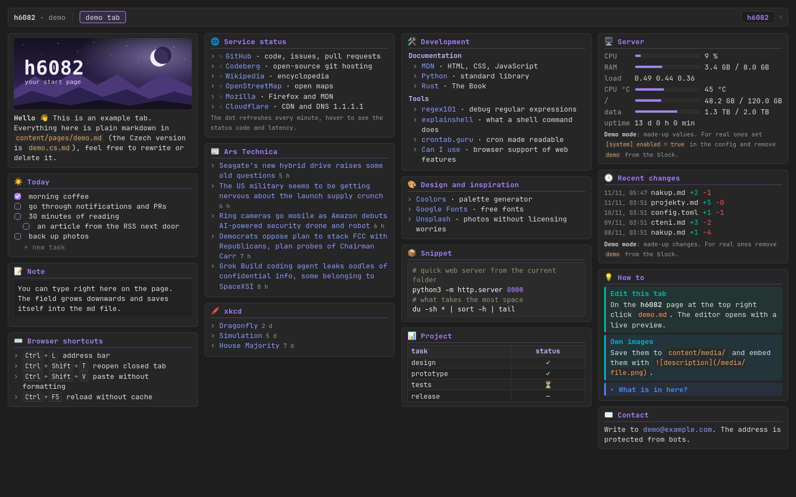
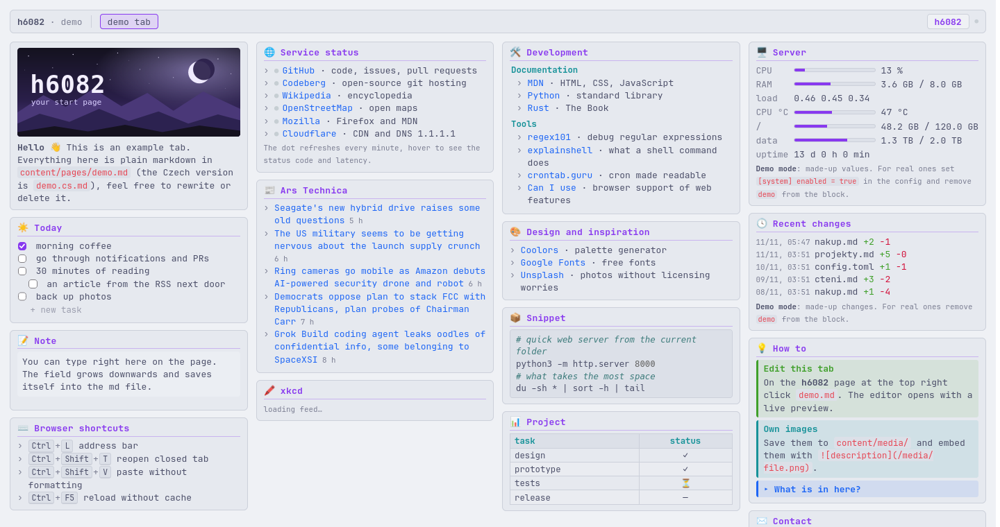
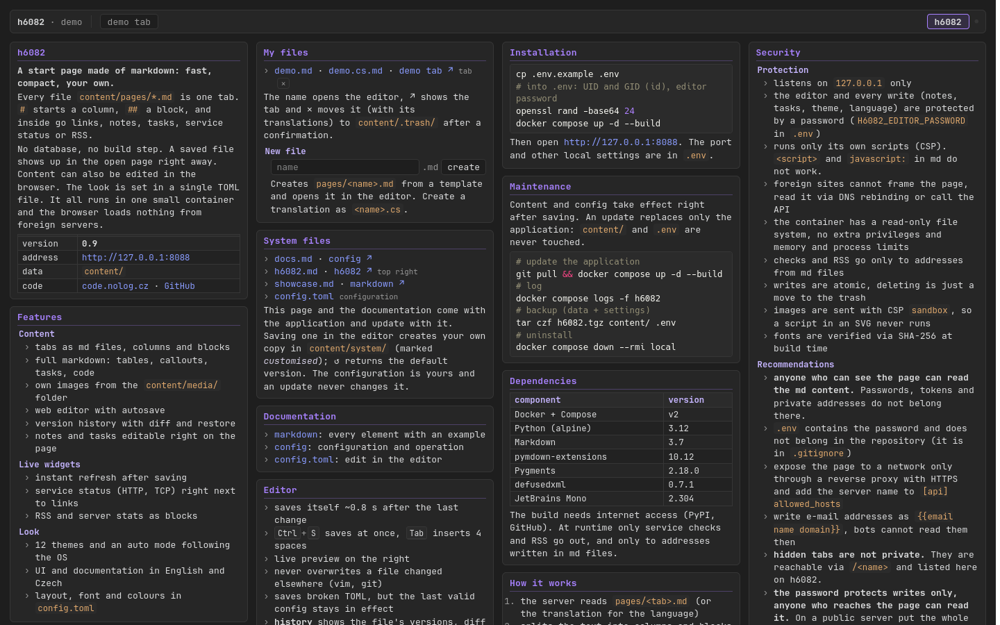
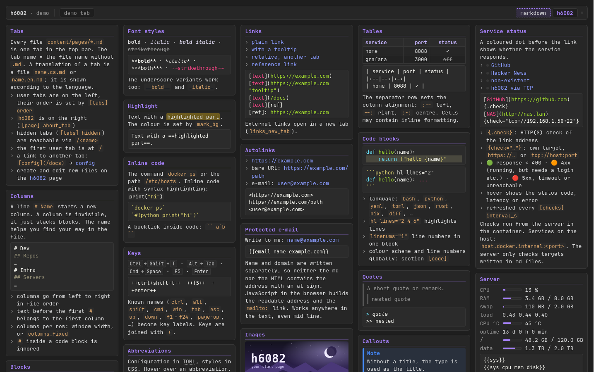
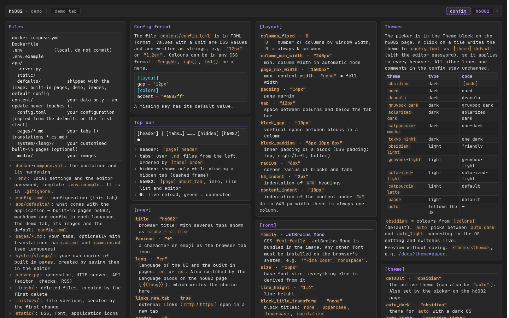

<h1 align="center">h6082</h1>

<p align="center">
  <b>Your start page, written in markdown.</b><br>
  Links, notes, tasks, live service status and feeds — in plain text files you own.
</p>

<p align="center">
  <a href="https://h.6082.cz/"><b>▶&nbsp;Live demo — h.6082.cz</b></a>
  &nbsp;·&nbsp;
  <a href="#quick-start">Quick start</a>
  &nbsp;·&nbsp;
  <a href="#features">Features</a>
  &nbsp;·&nbsp;
  <a href="#a-look-inside">Screenshots</a>
  &nbsp;·&nbsp;
  <a href="#security">Security</a>
</p>

**A self-hosted homepage and dashboard written in markdown.**
Lightweight alternative to Homepage, Homer, Dashy and Heimdall: no database, no YAML sprawl, no JS framework. Every tab is a markdown file you own.

Bookmarks, service status monitoring (HTTP/TCP), RSS feeds, server stats, tasks and notes on one page. Runs as a single Docker container, live reload, built-in web editor.

<p align="center">
  <a href="https://h.6082.cz/"></a>
</p>

---

## Markdown in, start page out

Every file in `content/pages/` is a tab. A `#` starts a column, a `##` a framed block — everything else is
the markdown you already know.

```markdown
# Work
## Today
- [x] morning coffee
- [ ] review pull requests

## Services
- [GitHub](https://github.com){.check} · code and issues
- [NAS](http://nas.home.arpa){check="tcp://nas.home.arpa:22"}

# News
## Hacker News
{{rss https://news.ycombinator.com/rss 8}}
```

That is the whole format. Save the file and every open browser tab refreshes itself.

## Why h6082

- **Plain files, zero lock-in.** No database, no build step, no account. Your start page is a folder of
  markdown you can grep, diff, back up and keep in git.
- **Fast and calm.** A compact layout in JetBrains Mono, no ads, no trackers, and the
  browser loads nothing from third-party servers.
- **Alive when you need it.** Service status dots, RSS, server stats, editable notes and tasks — right
  where your links are.
- **Edit anywhere.** A built-in web editor with live preview, autosave, conflict detection and full
  version history. Or just use vim.
- **Safe by default.** Hardened container, strict CSP, password-protected writes and a read-only mode
  for public pages. Updates never touch your data.

## Features

| | |
|---|---|
| **Content** | tabs from md files · invisible columns and framed blocks · tables, callouts, code with highlighting, footnotes, keys, abbreviations · own images · protected e-mail addresses |
| **Live widgets** | HTTP/TCP status dot next to any link · RSS and Atom feeds · server stats (CPU, RAM, temperature, disks) · demo mode with made-up data for public pages |
| **Editing** | web editor with live preview and autosave · tasks you tick, add and delete right on the page · notes that grow as you type · version history with diff and restore · trash instead of delete |
| **Look** | 12 themes (obsidian, nord, dracula, gruvbox, solarized, catppuccin, tokyo night, paper…) plus auto light/dark · your own themes in a few lines of TOML · layout, font and colours configurable |
| **Languages** | UI and built-in documentation in English and Czech · translations of your own tabs side by side (`name.cs.md`) |
| **Operations** | one small container · instant live reload · update-safe: built-in content ships in the image, your data stays in `content/` |

<p align="center">
  
  <br><sub>The same tab in the light <i>catppuccin latte</i> theme.</sub>
</p>

## A look inside

The documentation is not a wiki somewhere else — it is part of the page, written in the same markdown.

<p align="center">
  
  <br><sub><b>h6082</b> — the control page at the top right: overview, theme and language pickers, your files with
  editor links, installation, maintenance and security notes.</sub>
</p>

<p align="center">
  
  <br><sub><b>markdown</b> — every element with a live example next to its source: blocks, text styles, links,
  tasks, tables, code, callouts, notes, service status, server stats, history and RSS.</sub>
</p>

<p align="center">
  
  <br><sub><b>config</b> — operation and configuration: file layout, updates, endpoints, security and every
  option of <code>config.toml</code> with its default.</sub>
</p>

## Quick start

```bash
git clone https://code.nolog.cz/hindrich/h6082.git && cd h6082
cp .env.example .env          # UID/GID, port, editor password
docker compose up -d --build
```

Open <http://127.0.0.1:8088>. The first start creates `content/` with a default configuration and a demo
tab to play with. The full documentation lives inside the app: open the **h6082** tab at the top right.

### Settings (`.env`)

| Variable | Meaning |
|---|---|
| `H6082_UID`, `H6082_GID` | user the container runs as (owner of `content/`) |
| `H6082_BIND`, `H6082_PORT` | where the page listens, default `127.0.0.1:8088` |
| `H6082_EDITOR_USER`, `H6082_EDITOR_PASSWORD` | login for the editor and every write |
| `H6082_ALLOWED_HOSTS` | extra host names, e.g. your domain behind a reverse proxy |
| `H6082_READONLY` | `1` = public read-only page (see below) |

Everything else — themes, layout, language, widgets — is in `content/config.toml`, editable right in the
browser.

## Your data stays yours

```text
app/defaults/   ships with the image: built-in pages, demo tab, default config
content/        yours only: tabs, config.toml, media, history, trash
```

An update replaces the application and nothing else. Your tabs and `config.toml` are never overwritten,
new options simply use their defaults, and the demo tab is copied only on the very first start.
Updating is just:

```bash
git pull && docker compose up -d --build
```

## Security

- **Writes need a password** (HTTP Basic, constant-time comparison, delay after a wrong attempt).
- **Strict Content-Security-Policy** with per-response nonces — scripts in markdown never run.
- **No framing, no DNS rebinding**: only the configured host names are answered, everything else gets `421`.
- **Hardened container**: read-only file system, no capabilities, `no-new-privileges`, memory and process limits.
- **Outgoing requests only to targets written in your md files** — the server cannot be turned into a scanner.
  Feeds are parsed with `defusedxml`.
- **Supply chain**: pinned package versions, fonts verified by SHA-256 at build time.

### Read-only mode — for public pages

`H6082_READONLY=1` turns h6082 into a page nobody can change: every write returns `403`, the controls
disappear, the content comes only from the image and no volume is needed. Visitors can still switch
theme and language — stored only in their own browser. That is exactly how the
[live demo](https://h.6082.cz/) runs: read-only container, no volume, no secrets.

## Under the hood

A single Python file on the standard library HTTP server, with
[Python-Markdown](https://python-markdown.github.io/), [PyMdown Extensions](https://facelessuser.github.io/pymdown-extensions/)
and [Pygments](https://pygments.org/). No JavaScript framework, no database, no build step for your content.

| Component | Licence |
|---|---|
| JetBrains Mono | OFL-1.1 |
| Python-Markdown | BSD-3-Clause |
| PyMdown Extensions | MIT |
| Pygments | BSD-2-Clause |
| defusedxml | PSF-2.0 |

---

<p align="center">
  Made by <b>Mani Hindrich</b> ·
  <a href="https://code.nolog.cz/hindrich/h6082">code.nolog.cz/hindrich/h6082</a> ·
  <a href="https://github.com/manihindrich/h6082">GitHub mirror</a>
</p>
